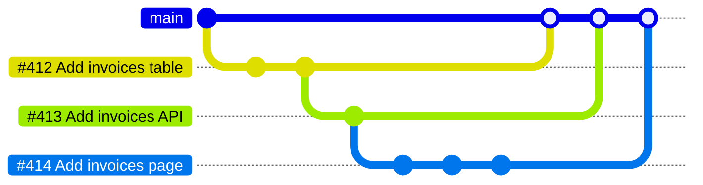

> [!NOTE]
> Since I wrote this post, GitHub has released native support for stacked pull requests, generally available since October 6, 2026 (see the [official documentation](https://docs.github.com/en/pull-requests/how-tos/stacked-pull-requests)). I no longer use Graphite now that stacking is built into GitHub.

Have you ever felt overwhelmed by a huge pull request? Or maybe that colossal pull request was yours? So, you tried to split it up manually into multiple pull requests, but as soon as you merged one, they all started conflicting because it was squashed, and the remaining branches were still built on original commits that main no longer had? 😵‍💫

That's the problem [Graphite](https://graphite.dev/) solves, it's a tool built around stacked pull requests.

## Why Graphite?

Smaller pull requests are a breeze to review, and **you can keep working on top of them before they're even merged!**

The idea is smaller pull requests, so developers keep moving and code ships faster. Graphite sits on top of GitHub, and there's a VS Code extension too.

## The Power of Stacking

Stacking means building on existing code without waiting for it to merge first. Think of it as layering changes, where each layer is a neat, focused change. It reminds me of [Phabricator](https://www.phacility.com/phabricator/) (used by Meta and many others).

  <Image
    alt={`Graphite example of stacking pull requests`}
    src={`/static/images/graphite-the-end-of-mammoth-pull-requests-my-experience/graphite_example.png`}
    width={600}
    height={239}
  />

I've seen people review pull requests commit by commit. Unfortunately, GitHub doesn't make that easy, you'll often end up commenting on individual commits rather than the pull request. You'll probably also have to read through WIP commits (if they weren't squashed) and jump back and forth to follow each part of the change, while stacked PRs keep each set of related changes in its own pull request.

Keeping pull requests small makes them easy to understand. It's way simpler to spot issues in a short change than in a long, winding one.

## Stay Unblocked and Ship Faster

Pending reviews don't block you, since you keep stacking on top of them, and Graphite merges each change as soon as it gets the green light. If you've got a bunch of changes ready to roll, one click and the merge queue merges the whole stack for you, handling the rebases along the way.

## My Experience

Say you're working on a feature that needs a database change, a backend adjustment, and a frontend update. Instead of one massive PR with all these changes, you can have three stacked PRs with Graphite. The first PR handles the database, the second builds on the first and tweaks the backend, and the third updates the frontend on top of the second. That's the stack drawn at the top of this post. Each PR is small and focused, so it's easier to review.

Stacking also helps when you're introducing something new and want to refactor something else to make it more concise. The two are related, but it doesn't make sense for the reviewer to review both changes in the same pull request. Stack them, and keep working on top of the latest one.

One last example: we were multiple major versions behind on a library, with a significant number of breaking changes. We made a stacked pull request for every major bump, which made it a breeze to review. You just had to check that version's release notes and migration guide and compare the diff, rather than reading ten migration guides and tracking the relevant changes within a single pull request.

## A Fresh Take on Git

If you love working from the terminal, there's the Graphite CLI, which manages your branches for you. If you'd rather stay in VS Code, the Graphite extension does the same from your editor: rebasing, making changes, and sorting out merge conflicts.

I won't go through specific commands because they've been changing fast and I don't want to write outdated information here, but I can talk a little bit about principles.

First, you need to track a branch, and when you do, Graphite asks you for its parent branch. If you already branched off another branch, well, Graphite is smart enough to suggest it as the parent. Then you can start stacking pull requests on top of it. If you change something in one of those branches, you can restack your pull requests so they're all up to date. No need to manually call `git rebase` on them and deal with nonsense conflicts.

My workflow is usually:

1. Track branch, parent from `main`
1. Create a new branch
1. Track the new branch, parent from the previous branch
1. Repeat steps 2 and 3 until I'm done with my feature
1. Submit my stack to GitHub via the CLI, which automatically creates all pull requests on GitHub with the proper target branch

Once the first pull request of the stack is merged, you can sync your repo, which deletes merged branches and restacks pull requests that were based on the merged branch. If you would like to merge multiple pull requests from the same stack, well, lucky you! The merge queue I mentioned earlier merges the whole stack for you and handles the rebases, so you don't have to babysit each PR through CI (always taking forever).

## Wrapping Up

Graphite is a different way to think about code reviews. Pull requests stay small and focused, and reviews either go faster or at least stop being blockers.

If you want to jump on board, Graphite is live on [Product Hunt](https://www.producthunt.com/posts/graphite-6).
